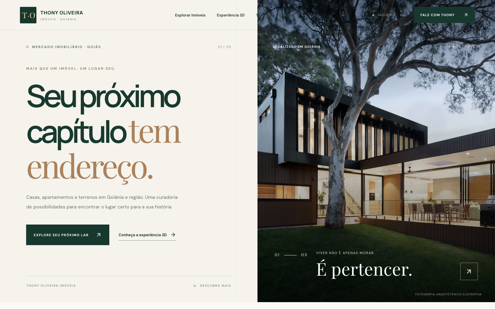

# Thony Oliveira Imóveis — Goiânia

Protótipo navegável, editorial e responsivo para uma futura plataforma imobiliária voltada a **Goiânia e região**. Criado para demonstração na NexaCloud.

## Prévia visual



## O que funciona

- **Home premium:** hero arquitetônico, busca filtrável, cartões demonstrativos e links de exploração.
- **Visita imersiva (scroll = linha do tempo):** fotos e vídeo fotorrealistas avançam quadro a quadro com a rolagem — fachada → hall → sala → cozinha → suíte → sai pelo deck/piscina → vista aérea, e o site continua. Rolar para cima faz o caminho inverso. Miniplanta mostra o cômodo atual.
- **Terreno → casa de 2 andares:** a mesma câmera acompanha terreno vazio ("Você batalhou."), fundação, estrutura, paredes, acabamento e a casa pronta ("Você conquistou. Agora é só morar."), com planta que se desenha e % da obra.
- **15 páginas estáticas de busca:** cada categoria tem HTML completo, título, meta description, texto informativo, FAQ e navegação interna.
- **Pesquisa SEO:** script e CSV com sugestões reais extraídas do Google Suggest (41 consultas iniciais; atualizar com o script).
- **Sem backend:** Vite + React; as experiências são um canvas 2D leve (`src/components/ScrollFilm.jsx`), sem WebGL. Output estático e pronto para hospedagem.

## Requisitos

Node.js 20.19+ ou 22.12+; npm.

```bash
npm install
npm run dev
# abra http://localhost:5173

npm run build
# publique o diretório dist/ como site estático
```

## Deploy na NexaCloud

Publicado em **https://thony-oliveira-imoveis.nexaclouds.online** (projeto `thony-oliveira-imoveis`, preset Vite, Node 22).
O workflow `.github/workflows/nexacloud.yml` (gerado pelo NexaCloud) roda a cada push no `main`: `npm ci` → `npm run build` → envia `dist/`.
Pull requests ganham prévia própria. Variável de produção: `SITE_URL` (canônicas e sitemap das páginas de SEO).

Limites do NexaCloud por deploy: 25 MB por arquivo e 95 MB no total; na prática, acima de ~490 arquivos o envio falha (500). Por isso as sequências vão em mosaicos 2×2 (4 quadros por arquivo): ~243 arquivos no total.
Não redirecione tudo para `/index.html`: existem rotas estáticas reais `/explorar/.../index.html`.

## DEMO MODE: proteção contra anúncios fictícios

**Atenção:** imagens, descrições e áreas da home são demonstrativas. Não correspondem a imóveis reais disponíveis. Não foram inventados CRECI, endereço comercial, número de WhatsApp nem depoimentos.

Por padrão o site está em modo demonstração e recebe `noindex,nofollow`; assim o protótipo não compete no Google com anúncios fictícios.

Para produção:
1. Substitua cartões e imagens pelos **anúncios reais e autorizados**, preços e descrições verificadas.
2. Configure `VITE_WHATSAPP_NUMBER=5562XXXXXXXXX`.
3. Configure `VITE_DEMO_MODE=false`.
4. Configure `SITE_URL=https://seudominio.com.br` no build.
5. Confirme titularidade de negócio, CRECI se aplicável, política de privacidade, termos e dados de contato.
6. Rode novo build, revise conteúdo e envie o sitemap gerado ao Google Search Console.

Variáveis no arquivo `.env.example`.

## Palavras-chave e arquitetura

Execute na raiz:

```bash
python3 scripts/coletar-sugestoes.py
```

Gera:
- `seo/consultas-google-suggest.json` (origem e sugestões por consulta);
- `seo/mapa-palavras-chave.csv` (termos, intenção estimada e página correspondente).

**Atenção:** Google Suggest não fornece volume mensal nem dificuldade SEO. A localização é Brasil (`gl=br`) e as palavras incluem Goiânia; o resultado pode mudar e não é um ranking exclusivo de dispositivos em Goiás. Use Google Ads Keyword Planner e Search Console para números reais depois do lançamento.

Evite criar páginas repetidas trocando uma palavra. A estratégia atual usa **páginas por intenção distinta**, com conteúdo útil e espaço para anúncios reais.

## Origem visual

- Direção editorial inspirada na referência em vídeo enviada pelo solicitante.
- Fotografias de inspiração arquitetônica do Unsplash (`images.unsplash.com`), todas identificadas como imagens ilustrativas.
- Visita e obra: quadros-chave gerados por IA (Google Flow · Nano Banana) e vídeos com quadro inicial/final (Flow · Omni 1.2 Flash 720p), identificados no site como ilustrativos. **Não são imóveis à venda.**

## Como a mídia das experiências é produzida

1. Quadros-chave 16:9 no Flow; as etapas da obra são edições da mesma foto (mesma câmera).
2. Vídeo de 10 s entre cada par de quadros (início → fim).
3. Quadros extraídos e convertidos em WebP (`public/experience/<tour|build>/seq/<largura>/0000.webp`), carregados em ordem progressiva (1 a cada 16 → todos). Sem a sequência, o site usa os quadros-chave com transição.

## Estrutura

```
src/App.jsx                         Home + busca demonstrativa
src/components/ScrollFilm.jsx       Motor: rolagem → quadro (sequência de vídeo ou quadros-chave), parallax do ponteiro, capítulos
src/components/HouseTour.jsx        Visita imersiva (7 capítulos + miniplanta)
src/components/HouseBuild.jsx       Terreno → casa de 2 andares (6 etapas + planta + % da obra)
src/experience.js                   Onde ficam as imagens/sequências de cada experiência
public/experience/                  Quadros-chave (stills) e sequências de vídeo em WebP
src/styles.css                      Design system responsivo
scripts/generate-pages.mjs          15 páginas SEO estáticas
scripts/coletar-sugestoes.py        Coleta de autocomplete
public/images/                      Fotos ilustrativas
public/landing.css                  Estilo das páginas SEO
seo/                                Mapa de palavras-chave
```

## Próximos passos

Integrar catálogo de imóveis (CMS/banco), filtros reais por preço/área, páginas individuais com dados estruturados fiéis ao anúncio, galeria fotográfica por imóvel, agendamento e analytics com consentimento. Para visitas 3D de **imóveis reais**, será preciso importar modelos GLB, scans ou panoramas com autorização.
